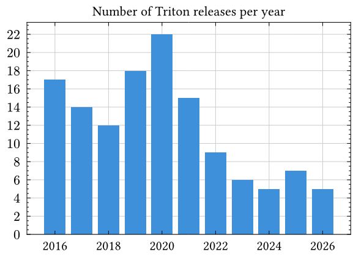

On 18th October 2016, exactly 10 years ago, Triton v0.0.1 was submitted to SpigotMC,
the marketplace where it is still sold to this day.
I am incredibly thankful to everyone that has been part of the community;
Triton wouldn't be what it is today without you.

This post is a reflection of what the Triton project
has been through and what the future awaits.

<!-- truncate -->

## History

Back in 2015 I ran my own Minecraft server,
for which I implemented multi language support via a [custom plugin][icg-hub].
Sadly, that server was shut down in early 2016.
When that happened,
I decided to take that code and repackage it into a more generic plugin
that could be published online and used by anyone.

When Triton launched in 2016,
it wasn't called Triton,
but instead MultiLanguagePlugin, or rather MLP.
In 2018, I did not have the motivation to continue developing the plugin,
so my friend at the time took over the development.
One of the changes they made was rebranding to Triton and releasing v1.0.0.
A few months later, they also dropped out,
and so I took over again and have been maintaining it since then.

TWIN launched in December 2018 along with Triton v1 to ease the configuration burden,
given Triton switched to a less human-friendly, albeit more flexible, translation format.

Under the hood, Triton v1 also changed from directly hooking into NMS internals,
to delegating packet interception to ProtocolLib.

Triton v2 was released less than an year later, in September 2019,
introducing the `translations` folder layout available to this day,
and the "patterns" feature.

Triton v3 in July 2020 brought improved MySQL support,
allowing translations to be stored there as well.
This was the major version of Triton for almost 6 years!

In July 2021, Triton became open source at the request of many community members.
While I was worried this might impact sales,
I am a strong believer in open source software and the FOSS movement,
so it only seemed right.
Furthermore, people that didn't/couldn't pay were getting it from leaked sources instead,
unnecessarily putting their computers at risk of malware.
I can't be sure this didn't negatively impact sales,
but I still stand by my decision regardless.
TWIN was open sourced later in January 2023.

[Triton v4] released earlier this year has made further major changes,
switching to Adventure as the message parser,
and an experimental mode that uses PacketEvents instead of ProtocolLib.
These changes significantly improve maintainability
and reduce breakage with new Minecraft versions.

## Statistics

Triton has reached 1000 sold licenses in September 2025,
and the number keeps growing every month.
Sadly, perhaps due to AI, Minecraft decreasing in popularity,
and/or even less frequent updates, sales have been stagnating since 2023,
with 2026 on-track to be the worse year since 2019.

Updates have also become less frequent, which I do not consider a negative thing.
From my point of view, it means Triton is a mature plugin that mostly just works.

As a fun fact, the most downloaded Triton version on SpigotMC is v3.11.0 from July 2024
with 210 downloads,
probably because its successor was released a whopping 6 months after!

## The Future

Triton is here to stay for the time being, despite the less frequent updates.
With my personal life and responsibilities taking an increasingly amount of time,
I have had little time to continue working on Triton,
but I still want to ensure it works with new Minecraft versions.
Thankfully, maintenance is relatively low as Triton is a mature project by now.

One of the things I want to improve in Triton v5
is to finish the PacketEvents migration and fully remove ProtocolLib,
as it is much easier to implement and does not require as many hacks and workarounds.
MiniMessage will probably become the default in translations too,
but special care will be taken to ensure existing translations keep working as expected.
Furthermore, TWIN is in deep need of maintenance and improvements,
but that can happen separately.

[icg-hub]: https://bitbucket.org/islandcraftgames/islandcraftgames-hub/src/master/src/net/islandcraftgames/api/language/
[Triton v4]: ../2026-04-11-triton-v4-released.md
